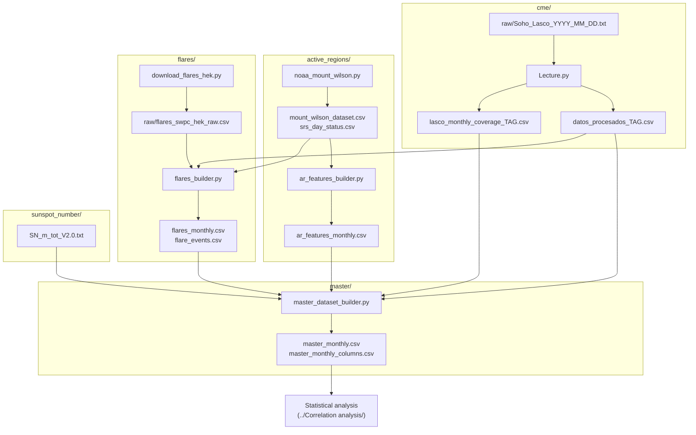

# Data Directory

This folder holds the data and processing scripts of the CME monthly occurrence project. Each phenomenon has its own folder with its scripts, inputs, outputs and README; the `master/` folder joins them into the monthly dataset used by the statistical analysis.

> **Status (2026-10-24).** CME, active-region and flare inputs have been reprocessed with corrected scripts (CDAW catalog downloaded 2026-07-31, SRS reports to 2026-07-31, SWPC flare list to 2026-07, processed by `flares/flares_builder.py`). All sources are joined by the new `master/master_dataset_builder.py` into `master/master_monthly.csv` (1996-01 → 2026-07, 367 months, 103 columns, with a data dictionary). See [Known issues](#known-issues-and-pending-changes).

## Folder structure

```
Data/
├── README.md                this file: overview, execution order, conventions
├── cme/                     SOHO/LASCO CDAW CME catalog → event table, observing gaps, monthly coverage
├── active_regions/          NOAA Solar Region Summaries → daily region records → period features
├── flares/                  NOAA/SWPC GOES flare list (HEK) and Plutino et al. (2023) catalogue
├── sunspot_number/          SILSO monthly sunspot number (cycle reference)
└── master/                  monthly master dataset joining all sources
```

| Folder | Phenomenon | Source | Main outputs | README |
|---|---|---|---|---|
| `cme/` | Coronal mass ejections | [SOHO/LASCO CDAW catalog](https://cdaw.gsfc.nasa.gov/CME_list/) | `datos_procesados_TAG.csv`, `lasco_gaps_TAG.csv`, `lasco_monthly_coverage_TAG.csv` | [cme/README.md](cme/README.md) |
| `active_regions/` | Sunspot groups / active regions | [NOAA Solar Region Summaries](https://www.ngdc.noaa.gov/stp/space-weather/swpc-products/daily_reports/solar_region_summaries/) | `mount_wilson_dataset.csv`, `srs_day_status.csv`, `ar_features_{annual,monthly,weekly}.csv` | [active_regions/README.md](active_regions/README.md) |
| `flares/` | Solar flares | NOAA/SWPC GOES flare list via the [HEK](https://www.lmsal.com/hek/); Plutino et al. (2023) | `flare_events.csv`, `flares_monthly.csv` | [flares/README.md](flares/README.md) |
| `sunspot_number/` | Solar-cycle reference | [SILSO](https://www.sidc.be/silso/) | `SN_m_tot_V2.0.csv` | [sunspot_number/README.md](sunspot_number/README.md) |
| `master/` | All of the above, monthly | outputs of the other folders | `master_monthly.csv`, `master_monthly_columns.csv` | [master/README.md](master/README.md) |

## Pipeline



## Execution order

The four source folders are independent of each other; `master/` comes last. Every script reads and writes in its own folder by default, so it can be run from anywhere.

```bash
# CMEs (after downloading the CDAW catalog into cme/raw/)
python Data/cme/Lecture.py --input Data/cme/raw/Soho_Lasco_2026_07_31.txt --tag 2026_07_31

# Active regions
python Data/active_regions/noaa_mount_wilson.py --start 1996-01-01 --end 2026-08-01
python Data/active_regions/ar_features_builder.py --start 1996-01 --end 2026-07

# Flares (download requires: pip install "sunpy[net]")
python Data/flares/download_flares_hek.py --start 1996-01 --end 2026-07
python Data/flares/flares_builder.py --cme-tag 2026_07_31 --start 1996-01 --end 2026-07

# Sunspot number: download SN_m_tot_V2.0.csv from SILSO into Data/sunspot_number/

# Master dataset (last month = last month covered by all sources)
python Data/master/master_dataset_builder.py
```

Requirements: Python ≥ 3.8, `numpy`, `pandas`, `requests`; `tqdm` (optional); `sunpy[net]` for the flare download only.

## Conventions

- **Raw versus derived files.** Files downloaded from external sources are stored unchanged (in a `raw/` subfolder where a folder has several). Everything else is regenerated by the scripts.
- **Versions.** Record the download date of every raw file (in its name, e.g. `Soho_Lasco_2026_07_31.txt`, or in its README). CDAW revises past entries, the HEK can change, and SILSO revises its most recent months.
- **Tags.** `Lecture.py` outputs carry the CDAW download date (`TAG`); the master builder must point to the same `TAG`.
- **Checksums.** Folders with external raw files keep a `SHA256SUMS` file (`sha256sum *.csv > SHA256SUMS`).
- **Caches.** `active_regions/srs_cache/` and `flares/hek_cache/` are download caches and are not versioned (see `../.gitignore`).
- **Missing data are not zeros.** Months without LASCO observations (`cme/`), days without SRS reports (`active_regions/srs_day_status.csv`) and, later, GOES gaps are recorded explicitly and propagated as `NaN`, not as zero counts.
- **Time.** All times are UT. SRS records carry the observation date (positions valid at 24:00 UT), not the report date.
- **Column language.** The CME event table keeps legacy Spanish names (`Fecha`, `Ancho`, `Rapidez`, …); everything else is in English. Names will be unified in the pipeline refactor.

## Known issues and pending changes

| # | Issue | Status |
|---|---|---|
| 1 | 37 months only partially observed by LASCO | `lasco_coverage` and `*_norm` counts in the master; count models should use a coverage offset |
| 2 | 64 % of CDAW events flagged Poor / Very Poor, concentrated in narrow and slow CMEs | `quality` flag available; analyses to be repeated without them |
| 3 | βδ placed below βγ in the ordinal complexity scale | `is_delta` and δ-area features added; scale decision pending |
| 4 | NOAA region missing for most M/X flares of 1997–2001 and 2022–2023 in the HEK copy of the SWPC list | Region-based flare features biased low in those years; to be filled from NOAA/NCEI GOES reports and NASA DONKI |
| 5 | Cycle 25 still in progress; SILSO value of 2026-07 provisional | `flag_sunspot_provisional`; rebuild when SILSO publishes definitive values |
| 6 | Active-region columns renamed (`n_total` → `n_regions`, …) | Mapping in `master/README.md` |
| 7 | `../Correlation analysis/` scripts use the previous column names (`n_total`, `n_large`, `n_alta_complejidad`, …) | To be updated in the pipeline refactor |

Resolved in the current scripts: months without LASCO observations counted as zero CMEs (now NaN in the master); flares missing from the master; GOES scale change (dated 2020-03 in the data) and duplicated events in the SWPC flare list; truncated CDAW remarks and dropped `*` values; SRS report date used as observation date; days without spotted regions indistinguishable from missing reports; NOAA numbers truncated to 4 digits; mixed-case McIntosh classes; active regions grouped by truncated numbers; missing SRS days counted as zeros; "ephemeral" persistence class renamed. Details in each folder's README.
