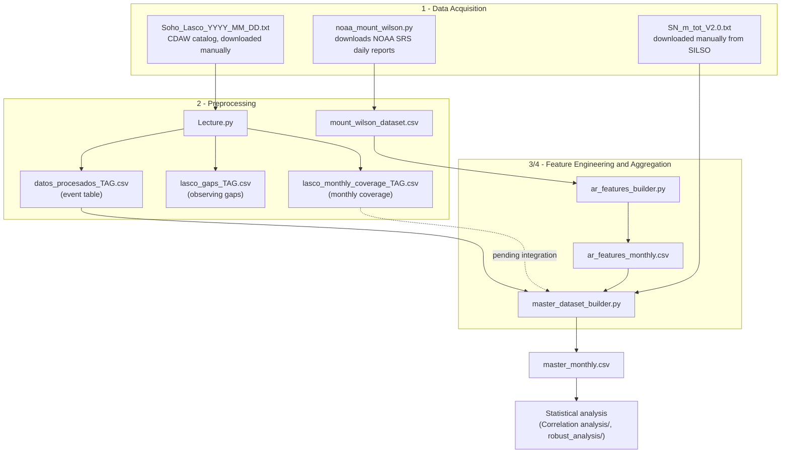

# Data Directory

This folder holds the datasets and processing scripts of the CME (Coronal Mass Ejection) monthly occurrence project. It covers data acquisition, preprocessing, and feature engineering for CME and solar Active Region (AR) data, and produces the monthly master dataset used by the statistical analysis.

> **Status (2026-10-24).** `Lecture.py` has been rewritten (see [`Lecture.py`](#lecturepy)) and validated on the CDAW catalog downloaded on 2026-07-31. `master_dataset_builder.py` does **not yet** use the new observing-coverage file; until it is updated, the monthly CME counts in `master_monthly.csv` still treat the 1998–1999 SOHO interruptions as months with zero CMEs. See [Known issues and pending changes](#known-issues-and-pending-changes).

---

## Pipeline Overview

The project workflow follows five stages:

1. **Data Acquisition** — retrieve raw CME and Active Region data from their public sources.
2. **Data Preprocessing** — clean, parse, and standardize each raw source independently, and document observing gaps.
3. **Feature Engineering** — derive CME subpopulations and AR-based variables, then merge everything into a single master dataset.
4. **Monthly Aggregation** — monthly counts per CME subpopulation and AR category.
5. **Statistical Analysis** — carried out by the scripts in `../Correlation analysis/` and `../robust_analysis/` (outside the scope of this folder).

Stages 1–4 are implemented here. Their final output, `master_monthly.csv`, is the entry point of stage 5.

### Execution order



### Step-by-step

| Order | Script | Input | Output | Notes |
|---|---|---|---|---|
| 0 | *(manual download)* | — | `Soho_Lasco_YYYY_MM_DD.txt` | CDAW text catalog (see [CME data](#cme-data-soholasco-cdaw-catalog)). Name the file with its download date. |
| 1 | `Lecture.py` | `Soho_Lasco_YYYY_MM_DD.txt` | `datos_procesados_TAG.csv`, `lasco_gaps_TAG.csv`, `lasco_monthly_coverage_TAG.csv` | Independent of step 2; can be run in parallel. |
| 2 | `noaa_mount_wilson.py` | NOAA SRS daily reports (downloaded automatically) | `mount_wilson_dataset.csv`, `mount_wilson_summary.csv` | Independent of step 1. Downloads are cached in `srs_cache/`. |
| 3 | `ar_features_builder.py` | `mount_wilson_dataset.csv` | `ar_features_annual.csv`, `ar_features_monthly.csv`, `ar_features_weekly.csv` | Requires the output of step 2. |
| 4 | *(manual download)* | — | `SN_m_tot_V2.0.txt` | SILSO monthly sunspot number (see [Sunspot data](#sunspot-data)). |
| 5 | `master_dataset_builder.py` | `datos_procesados_TAG.csv`, `ar_features_monthly.csv`, `SN_m_tot_V2.0.txt` | `master_monthly.csv` | Requires steps 1, 3 and 4. Edit `CME_FILE` so it points to the `TAG` produced in step 1. |

```bash
# Step 1 and 2 can run in either order, or in parallel
python Lecture.py --input Soho_Lasco_2026_07_31.txt --tag 2026_07_31
python noaa_mount_wilson.py --start 1996-01-01 --end 2026-07-31

# Step 3 depends on step 2's output
python ar_features_builder.py --input mount_wilson_dataset.csv --start 1996-01 --end 2026-07

# Step 4: download SN_m_tot_V2.0.txt from SILSO and place it in this folder

# Step 5 depends on steps 1, 3 and 4 (set CME_FILE and END_MONTH in the script first)
python master_dataset_builder.py
```

`TAG` is a free label passed to `Lecture.py`; use the download date of the CDAW catalog (e.g. `2026_07_31`) so every derived file can be traced to the catalog version that produced it.

---

## Datasets in this folder

| File | Produced by | One row per | Description |
|---|---|---|---|
| `datos_procesados_TAG.csv` | `Lecture.py` | CME event | Cleaned CDAW catalog with quality and uncertainty flags. See [column dictionary](#columns-of-datos_procesados_tagcsv). |
| `lasco_gaps_TAG.csv` | `Lecture.py` | Observing gap | Intervals without CMEs that are statistically incompatible with the local CME rate, i.e. periods without coronagraph observations. |
| `lasco_monthly_coverage_TAG.csv` | `Lecture.py` | Calendar month | Fraction of each month covered by observations. |
| `mount_wilson_dataset.csv` | `noaa_mount_wilson.py` | Active region per day | Daily NOAA SRS region records with Mount Wilson and McIntosh classifications. |
| `mount_wilson_summary.csv` | `noaa_mount_wilson.py` | Day | Daily counts and complexity summary. |
| `ar_features_monthly.csv` (and `_annual`, `_weekly`) | `ar_features_builder.py` | Period | AR-derived features (counts, complexity, persistence). |
| `master_monthly.csv` | `master_dataset_builder.py` | Calendar month | Final monthly dataset: CME counts by subpopulation, AR features and sunspot number. |
| `external/flares/` | external (see its README) | Flare | GOES flare catalogue of Plutino et al. (2023), 1986–2020, with checksums. Used by `../robust_analysis/flare_analysis.py`. |

The committed `datos_procesados_2026_02_28.csv` and `master_monthly.csv` were produced with the **previous** version of `Lecture.py` (truncated remarks, see [Known issues](#known-issues-and-pending-changes)). They are kept until the regenerated versions are committed.

---

## Data Sources

### CME data: SOHO/LASCO CDAW catalog

- Source: [SOHO/LASCO CME Catalog, CDAW Data Center (NASA/GSFC)](https://cdaw.gsfc.nasa.gov/CME_list/).
- Format: plain text, one CME per line, whitespace-separated, no header. Each line has 12 fixed fields followed by free-text remarks:

| # | Field (CDAW) | Example | Notes |
|---|---|---|---|
| 1 | Date | `1996/01/22` | UT, first appearance in the LASCO C2 field of view |
| 2 | Time | `03:11:01` | UT |
| 3 | Central position angle (CPA) | `105` or `Halo` | degrees, counter-clockwise from solar north; `Halo` for full halos |
| 4 | Angular width | `37` | degrees; `360` for full halos |
| 5 | Linear speed | `267` | km/s, linear fit to height–time points; `----` if not measured |
| 6 | 2nd-order speed, initial | `401` | km/s, at first height |
| 7 | 2nd-order speed, final | `130` | km/s, at last height |
| 8 | 2nd-order speed at 20 R☉ | `0` | km/s; CDAW writes `0` when it cannot be computed |
| 9 | Acceleration | `-126.3*` | m/s²; `*` = uncertain (only 3 height–time points or poor fit) |
| 10 | Mass | `7.1e+13*` | g; `-------` if not measured; `*` = uncertain |
| 11 | Kinetic energy | `2.5e+28*` | erg; same conventions as mass |
| 12 | Measurement position angle (MPA) | `103` | degrees, angle at which the height–time measurements were made |
| 13+ | Remarks | `Very Poor Event; Only C3` | free text, several items separated by `;` |

- The catalog is revised by CDAW over time (e.g. remarks such as `Fixed the MVI roll angle issue on 2026-01-30` or `Newly inserted on 2024/05/01.`). **Always record the download date**: two downloads of the same period may differ.

### Active region data

[NOAA/NGDC — Solar Region Summaries (SRS)](https://www.ngdc.noaa.gov/stp/space-weather/swpc-products/daily_reports/solar_region_summaries/), downloaded automatically by `noaa_mount_wilson.py`.

### Sunspot data

Sunspot numbers are **not included** in this repository. Download the monthly total sunspot number file (`SN_m_tot_V2.0.txt`) from [SILSO — Royal Observatory of Belgium](https://www.sidc.be/silso/) and place it in this folder; `master_dataset_builder.py` reads it automatically (set `SUNSPOT_FILE` if the name differs).

---

## Scripts

### `Lecture.py`

Reads the raw CDAW text catalog, cleans it, flags data quality and uncertain values, and documents the periods without coronagraph observations.

**Usage**

```bash
python Lecture.py --input Soho_Lasco_2026_07_31.txt --tag 2026_07_31 [--outdir .]
```

| Argument | Description | Default |
|---|---|---|
| `--input` | Path to the raw CDAW `.txt` catalog (required) | — |
| `--tag` | Suffix of the three output files; use the catalog download date | `2026_02_28` |
| `--outdir` | Output folder | current folder |

Requirements: Python ≥ 3.8, `numpy`, `pandas`.

**Processing steps**

1. **Line selection.** Only lines that start with a date (`YYYY/MM/DD HH:MM:SS`) are parsed; headers and blank lines are skipped.
2. **Field parsing.** The first 10 whitespace-separated tokens after date and time are the numeric fields 3–12 of the table above; everything after them is kept as the full remarks string. (The previous version split the remarks on spaces and kept only the first word, so `Very Poor Event; Only C2` became `Very` and `Only C2; Poor Event` became `Only`.)
3. **Missing and flagged values.**
   - Tokens made only of dashes (`----`, `-------`) → `NaN`.
   - A trailing `*` marks an uncertain value: the number is kept and a boolean flag is set (`accel_uncertain` for acceleration; `mass_uncertain` if mass or kinetic energy carries `*`). The previous version turned these values into `NaN`.
   - `Halo` in the CPA field → `Central = NaN` and `is_halo = True`.
   - Second-order speeds equal to `0` (not computable in CDAW) → `NaN`.
4. **Malformed lines.** A dated line with fewer than 10 numeric fields is not parsed; it is reported with its line number at the end of the run (none in the 2026-07-31 catalog).
5. **Derived columns.** `t` = date + time as a timestamp; `quality` from the remarks (`very_poor` if they contain "Very Poor", else `poor` if they contain "Poor", else `normal`); `only_c2` if the remarks contain "Only C2". Events are sorted by `t`.
6. **Observing-gap detection.** CMEs are recorded only when LASCO observes, so an empty interval can mean either "no CMEs" or "no data". For each interval of at least `GAP_MIN_DAYS` (3 days) between consecutive CMEs:
   - the local CME rate λ is estimated from the events in the `RATE_WINDOW` (30 days) before and after the interval, excluding the interval itself;
   - the probability of seeing no CME during the interval length Δt is computed as p = exp(−λ·Δt) (Poisson);
   - the interval is flagged as an observing gap if p < `GAP_P` (10⁻⁶).

   The threshold is deliberately strict: CMEs are clustered in time, so short lulls are more frequent than a Poisson process predicts (with p < 10⁻³ about 100 intervals of 2–3 days were flagged, most of them natural lulls). The months without coverage (below) are the same for any threshold between 10⁻³ and 10⁻⁹.
7. **Monthly coverage.** For each calendar month, `coverage` = 1 − (days of the month inside flagged gaps) / (days in the month).
8. **Report.** The script prints the number of events, malformed lines, halos, quality counts, missing speeds, uncertain values, the list of gaps and the months with coverage < `MIN_COVERAGE` (0.5).

**Configuration constants** (top of the script)

| Constant | Meaning | Default |
|---|---|---|
| `GAP_P` | Poisson probability below which an empty interval is flagged as a gap | `1e-6` |
| `GAP_MIN_DAYS` | Minimum interval length tested (days) | `3.0` |
| `RATE_WINDOW` | Days on each side used to estimate the local CME rate | `30.0` |
| `MIN_COVERAGE` | Coverage threshold reported, and suggested for the monthly builder | `0.5` |

#### Columns of `datos_procesados_TAG.csv`

Legacy Spanish names are kept for compatibility with `master_dataset_builder.py`; new columns are in English. Names will be unified in the planned pipeline refactor.

| Column | Type | Description |
|---|---|---|
| `Fecha` | date (YYYY-MM-DD) | Date of first appearance in C2 (UT) |
| `Hora` | time (HH:MM:SS) | Time of first appearance in C2 (UT) |
| `Central` | float, degrees | Central position angle; `NaN` for full halos |
| `Ancho` | float, degrees | Angular width; 360 for full halos |
| `Rapidez` | float, km/s | Linear speed; `NaN` if not measured |
| `Col4` | float, km/s | Second-order speed at the first height |
| `Col5` | float, km/s | Second-order speed at the last height |
| `Col6` | float, km/s | Second-order speed at 20 R☉; `NaN` when CDAW gives 0 |
| `Aceleracion` | float, m/s² | Acceleration (see `accel_uncertain`) |
| `Masa` | float, g | Mass (see `mass_uncertain`) |
| `Energia` | float, erg | Kinetic energy (see `mass_uncertain`) |
| `MPA` | float, degrees | Measurement position angle |
| `Comentarios` | text | Full CDAW remarks |
| `is_halo` | bool | CPA field was `Halo` |
| `accel_uncertain` | bool | Acceleration carried `*` in CDAW |
| `mass_uncertain` | bool | Mass or kinetic energy carried `*` |
| `t` | timestamp | `Fecha` + `Hora` |
| `quality` | `normal` / `poor` / `very_poor` | From the remarks ("Poor Event", "Very Poor Event") |
| `only_c2` | bool | Remarks contain "Only C2" (not tracked in C3) |

#### Columns of `lasco_gaps_TAG.csv`

| Column | Description |
|---|---|
| `start`, `end` | Timestamps of the last CME before and the first CME after the gap |
| `days` | Gap length (days) |
| `local_rate_per_day` | CME rate around the gap (CMEs/day, ±30 days) |
| `p_no_cme` | Poisson probability of no CME in the interval at that rate |

#### Columns of `lasco_monthly_coverage_TAG.csv`

| Column | Description |
|---|---|
| `yearmonth` | Calendar month (YYYY-MM) |
| `coverage` | Fraction of the month with observations (0–1) |
| `gap_days` | Days of the month inside flagged gaps |

#### Reference values: catalog downloaded on 2026-07-31

| Quantity | Value |
|---|---|
| Events | 43 440 (1996-01-11 → 2026-07-31) |
| Events up to 2026-02-28 | 42 744 (identical to the previous processed file) |
| Malformed lines | 0 |
| Full halos | 1 033 (`Halo` CPA = width 360°) |
| Quality | normal 15 841 (36 %), poor 14 948 (34 %), very poor 12 651 (29 %) |
| Linear speed missing | 119 |
| Acceleration missing / uncertain | 740 / 35 335 |
| Mass missing | 13 333 |
| Mass or kinetic energy uncertain | 5 200 |
| Second-order speed at 20 R☉ not computable | 10 432 |
| Observing gaps detected | 31 (318.5 days in total) |
| Months with coverage < 0.5 | 1998-07, 1998-08, 1998-09, 1999-01 (coverage 0) |

The two largest gaps are 1998-06-24 → 1998-10-15 (113 days, loss of contact with SOHO) and 1998-12-20 → 1999-02-05 (47 days). The remaining 29 gaps last 3–12 days, mostly in 1999–2002 and 2003–2004; they should be checked against the CDAW data-gap notes.

**Data quality depends strongly on the CME subpopulation** (2026-07-31 catalog):

| Subpopulation | n | normal | poor | very poor |
|---|---|---|---|---|
| All | 43 440 | 36 % | 34 % | 29 % |
| Width < 20° | 12 254 | 13 % | 30 % | 57 % |
| Width 20°–120° | 27 261 | 40 % | 39 % | 21 % |
| Partial halo (120°–359°) | 2 892 | 82 % | 15 % | 3 % |
| Full halo (360°) | 1 033 | 87 % | 12 % | 1 % |
| Speed ≥ 1000 km/s | 1 036 | 91 % | 6 % | 2 % |
| Speed ≥ 750 km/s and width ≥ 120° | 1 246 | 96 % | 4 % | 0 % |

The fraction of `normal` events also changes over time (about 15 % in 1996, 68 % in 2002, 11 % in 2008, 38 % in 2023). Analyses of the narrow/slow population should therefore be repeated without `poor` and `very_poor` events.

---

### `noaa_mount_wilson.py`

**Data source:** [NOAA/NGDC — Solar Region Summaries](https://www.ngdc.noaa.gov/stp/space-weather/swpc-products/daily_reports/solar_region_summaries/)

**What it does:**

1. **Downloads** the daily `.txt` files from NOAA for a configurable date range, using a local cache to avoid re-downloading.
2. **Parses** each file, locating the *"I. Regions with Sunspots"* section and extracting the tabular data for each region using regular expressions.
3. **Normalizes** the Mount Wilson magnetic classification (Alpha, Beta, Beta-Gamma, Beta-Gamma-Delta, etc.) into a standard format (α, β, βγ, βγδ...) and assigns it an ordinal complexity value.
4. **Builds** a detailed dataset (one row per active region per day) and a daily aggregated summary.
5. **Exports** both results to CSV and prints descriptive statistics to the console.

**Generated datasets:**

| File | Description |
|---|---|
| `mount_wilson_dataset.csv` | Detailed dataset: one row per active region detected each day. |
| `mount_wilson_summary.csv` | Daily summary: aggregated counts and complexity per date. |

**Columns in `mount_wilson_dataset.csv`:**

| Column | Description |
|---|---|
| `date` | Report date (YYYY-MM-DD) |
| `noaa_number` | NOAA number of the active region |
| `location` | Heliographic position (e.g. N14E23) |
| `lo` | Carrington longitude |
| `area` | Area in millionths of the solar hemisphere |
| `z_class` | Modified Zurich classification (McIntosh); letter case varies between years in the SRS |
| `ll` | Longitudinal extent (degrees) |
| `nn` | Number of sunspots |
| `mag_type_raw` | Magnetic type as it appears in the original report |
| `mag_type` | Normalized magnetic type (α, β, βγ, βγδ...) |
| `complexity` | Ordinal complexity value (1–5) |

**Mount Wilson complexity scale:**

| Type | Value |
|---|---|
| α (Alpha) | 1 |
| β (Beta) | 2 |
| βδ (Beta-Delta) | 3 |
| βγ (Beta-Gamma) / γ (Gamma) | 4 |
| γδ (Gamma-Delta) / βγδ (Beta-Gamma-Delta) | 5 |

> The placement of βδ (3) below βγ (4) is under review: δ configurations are the most flare-productive. A separate δ flag is planned (see [Known issues](#known-issues-and-pending-changes)).

**Main components:**

- `normalize_mag_type()` — normalizes the raw magnetic type text into the canonical format and its complexity value.
- `download_srs()` — downloads (or reads from cache) the SRS file for a given date, with retries and HTTP error handling.
- `parse_srs()` — extracts records from the "Regions with Sunspots" section using regex over fixed-width columns.
- `build_dataset()` — orchestrates the download and parsing process for the entire date range, returning a pandas `DataFrame`.
- `build_summary()` — groups by date and computes aggregated metrics (active regions, max/mean complexity, counts by type).

**Usage:**

```bash
python noaa_mount_wilson.py --start 1996-01-01 --end 2026-07-31 \
    --output mount_wilson_dataset.csv \
    --summary mount_wilson_summary.csv
```

| Argument | Description | Default value |
|---|---|---|
| `--start` | Start date (YYYY-MM-DD) | `2010-01-01` |
| `--end` | End date (YYYY-MM-DD) | `2025-12-31` |
| `--output` | Path for the detailed dataset CSV | `mount_wilson_dataset.csv` |
| `--summary` | Path for the daily summary CSV | `mount_wilson_summary.csv` |

---

### `ar_features_builder.py` — Period-based Mount Wilson Complexity Features

Builds aggregated features (annual, monthly, weekly) from `mount_wilson_dataset.csv`. For each period, every active region (AR) is represented once, using its **peak complexity** within that period — avoiding double-counting from multiple daily observations of the same region.

**What it does:**

1. **Loads** `mount_wilson_dataset.csv` and computes, for each active region (`noaa_number`), its **persistence** (`persistence_days`) — the number of days between its first and last appearance in the dataset. Because the SRS lists only regions with spots on the visible disk, persistence measures visibility (at most ~16 days, one disk passage), not the full lifetime of the region.
2. **Classifies** each region by persistence (`size_class`): `ephemeral` (≤ 1 day), `small` (2–6 days), `large` (≥ 7 days).
3. Flags regions of **high complexity** (≥ 4) and computes `complexity × area` per daily observation.
4. Creates period columns: `year`, `yearmonth`, `yearweek`.
5. **Aggregates** by period, using each region's **peak complexity** within that period: `n_total`, `n_high_complexity`, `complexity_area_sum`, `n_large`, `n_small`, `n_ephemeral`.
6. **Reindexes** monthly and weekly results to the full configured date range, filling periods with no active regions (deep solar minima) with zeros instead of leaving them absent.
7. Runs a **consistency check**: `n_large + n_small + n_ephemeral == n_total` for every year.
8. Saves `ar_features_annual.csv`, `ar_features_monthly.csv`, and `ar_features_weekly.csv`.

> **Counting unit.** A region observed across a month boundary is counted in both months. Monthly counts are therefore *region-months*: their sum over 1996-01 → 2026-02 is 7 719, whereas the number of unique NOAA regions in the same period is 6 422.

**Generated datasets:**

| File | Granularity |
|---|---|
| `ar_features_annual.csv` | One row per year |
| `ar_features_monthly.csv` | One row per calendar month, reindexed to the full date range |
| `ar_features_weekly.csv` | One row per ISO week, reindexed to the full date range |

**Columns:**

| Column | Description |
|---|---|
| `year` / `yearmonth` / `yearweek` | Period identifier |
| `n_total` | Active regions observed in the period (region-months for the monthly file) |
| `n_high_complexity` | Regions whose **peak** complexity in the period was ≥ `HIGH_COMPLEXITY` (default 4: βγ, γ, γδ, βγδ) |
| `complexity_area_sum` | Sum of `complexity × area` across all daily observations in the period (Φ_proxy) |
| `n_large` | Regions with persistence ≥ `THRESH_LARGE` days |
| `n_small` | Regions with persistence between `THRESH_EPHEMERAL` and `THRESH_LARGE` days |
| `n_ephemeral` | Regions with persistence ≤ `THRESH_EPHEMERAL` day |

**Configuration:**

| Constant | Description | Default |
|---|---|---|
| `THRESH_EPHEMERAL` | Max persistence (days) to classify a region as `ephemeral` | `1` |
| `THRESH_LARGE` | Min persistence (days) to classify a region as `large` | `7` |
| `HIGH_COMPLEXITY` | Complexity threshold for "high complexity" (βγ, γ, γδ, βγδ) | `4` |
| `DEFAULT_START_DATE` / `DEFAULT_END_DATE` | Full date range used to reindex monthly/weekly outputs | `1996-01` / `2026-02` |

**Usage:**

```bash
python ar_features_builder.py \
    --input mount_wilson_dataset.csv \
    --start 1996-01 --end 2026-07 \
    --outdir .
```

| Argument | Description | Default |
|---|---|---|
| `--input` | Path to the input dataset | `mount_wilson_dataset.csv` |
| `--start` | Start of the reindexing range (YYYY-MM) | `1996-01` |
| `--end` | End of the reindexing range (YYYY-MM) | `2026-02` |
| `--outdir` | Output directory for the generated CSV files | current directory |

---

### `master_dataset_builder.py` — Monthly Resolution

Combines the three preceding sources — CMEs, sunspot numbers, and AR features — into a single monthly master dataset.

**What it does (current version):**

1. **Loads sunspot numbers** (`load_sunspots`): reads the whitespace-separated SILSO text file, builds a `yearmonth` (YYYY-MM) column, filters to the configured year range, and replaces the SILSO missing-data marker (`-1`) with `NaN`.
2. **Loads and filters CMEs** (`load_cmes`): reads the CME table and builds monthly count columns:
   - By angular width: normal (20°–120°), partial halo (>120°–<360°), full halo (360°).
   - By speed: slow (0–600 km/s), moderate (600–1000 km/s), fast (1000–1500 km/s), extreme (≥1500 km/s).
   - A combined filter (`count_cmes_filtered`): speed ≥ `MIN_SPEED` and `MIN_WIDTH` ≤ width ≤ `MAX_WIDTH`.
   - All monthly counts are reindexed to the full date range, and months without events are set to `0`.
3. **Loads AR features** (`load_ar_features`): reads `ar_features_monthly.csv` and normalizes the period column to `yearmonth` in `YYYY-MM` format.
4. **Builds the master dataset** (`build_master`): left-joins the three sources onto a complete monthly index spanning `YEAR_START`–`YEAR_END`, keeps months missing in a source as `NaN`, and trims to `END_MONTH`.
5. **Runs diagnostics** (`print_diagnostics`): `NaN` counts per column, `frac_*` columns in `[0, 1]`, `n_large + n_small + n_ephemeral == n_total`, descriptive statistics.
6. **Saves** the result to `master_monthly.csv`.

> **Pending update.** Step 2 still fills every month without events with `0`, including the months without LASCO observations. The update will merge `lasco_monthly_coverage_TAG.csv`, set the CME counts to `NaN` when `coverage < 0.5`, add coverage-normalised counts (`count_cmes_*_norm` = count / coverage) for the remaining months, keep the raw counts for count models (with `log(coverage)` as offset), and add the new AR variables (total spot area, δ-region area, δ flag). Until then, the 1998–1999 interruptions appear as months with 0 CMEs.

**Output dataset — `master_monthly.csv` (one row per calendar month):**

| Column | Source | Description |
|---|---|---|
| `yearmonth` | — | Period (YYYY-MM) |
| `sunspot_number` | Sunspots | SILSO v2 monthly sunspot number |
| `count_cmes_all` | CMEs | Total CMEs that month (no filter) |
| `count_cmes_normal` | CMEs | CMEs with width 20°–120° |
| `count_cmes_partial_halo` | CMEs | CMEs with width >120°–<360° |
| `count_cmes_halo` | CMEs | CMEs with width == 360° (full halo) |
| `count_cmes_slow` | CMEs | CMEs with speed 0–600 km/s |
| `count_cmes_moderate` | CMEs | CMEs with speed 600–1000 km/s |
| `count_cmes_fast` | CMEs | CMEs with speed 1000–1500 km/s |
| `count_cmes_extreme` | CMEs | CMEs with speed ≥ 1500 km/s |
| `count_cmes_filtered` | CMEs | CMEs meeting the combined speed AND width filter |
| `n_total` | AR Features | Active regions in the month (region-months) |
| `n_high_complexity` | AR Features | ARs with peak complexity ≥ 4 (βγ, γ, γδ, βγδ). The committed CSV names this column `n_alta_complejidad` |
| `complexity_area_sum` | AR Features | Sum of `complexity × area` across all daily observations |
| `n_large` | AR Features | ARs visible ≥ 7 days |
| `n_small` | AR Features | ARs visible 2–6 days |
| `n_ephemeral` | AR Features | ARs visible ≤ 1 day |

**Configuration:**

| Constant | Description | Default |
|---|---|---|
| `CME_FILE` | Path to the processed CME table | `datos_procesados_2026_02_28.csv` |
| `SUNSPOT_FILE` | Path to the SILSO sunspot-number file | `SN_m_tot_V2.0 (1).txt` |
| `AR_FILE` | Path to the AR features CSV | `ar_features_monthly.csv` |
| `OUTPUT_FILE` | Output master CSV path | `master_monthly.csv` |
| `YEAR_START` / `YEAR_END` | Date range for the master index | `1996` / `2026` |
| `END_MONTH` | Final cutoff month for the output | `2026-02` |
| `MIN_SPEED` | Minimum CME speed (km/s) for `count_cmes_filtered` | `750` |
| `MIN_WIDTH` / `MAX_WIDTH` | Angular width range (degrees) for `count_cmes_filtered` | `120` / `360` |

The script reads its configuration from these constants (no CLI arguments). To use a new catalog, set `CME_FILE` to `datos_procesados_TAG.csv` and `END_MONTH` to the last month covered by **all** sources (CDAW, SRS and SILSO).

---

## Reproducibility Notes

- **Record versions.** For each raw file, keep its source URL, download date and checksum (`sha256sum`). CDAW revises past entries, and SILSO revises the most recent months.
- **Trace derived files.** The `TAG` of `Lecture.py` outputs should be the CDAW download date; `CME_FILE` in the master builder must point to the same `TAG`.
- **CME counts versus observing coverage.** A month with no CMEs in the catalog can mean "no CMEs" or "no observations". `lasco_monthly_coverage_TAG.csv` distinguishes the two; the master builder will use it (pending update).
- **Days with no NOAA SRS report** (HTTP 404) are skipped by `noaa_mount_wilson.py` and counted as "days with no data". They are not yet distinguished from days without spotted regions in the output.
- **Zero-filled periods** in `ar_features_monthly.csv` / `ar_features_weekly.csv` represent periods with no spotted regions (deep solar minimum), not missing data.
- **CSV format.** AR feature files use `csv.QUOTE_NONNUMERIC` and 4-decimal floats to avoid column-shifting in downstream parsers.
- **Diagnostics are warnings, not hard checks.** `print_diagnostics` and the `Lecture.py` report do not stop execution; review the printed output before using a dataset.
- **Independent CME breakdowns.** Width and speed categories each cover all CMEs; `count_cmes_filtered` combines a speed and a width condition. Do not sum width or speed categories expecting them to equal `count_cmes_filtered`. Note also that `count_cmes_filtered` overlaps the speed classes (it contains moderate, fast and extreme events).

---
